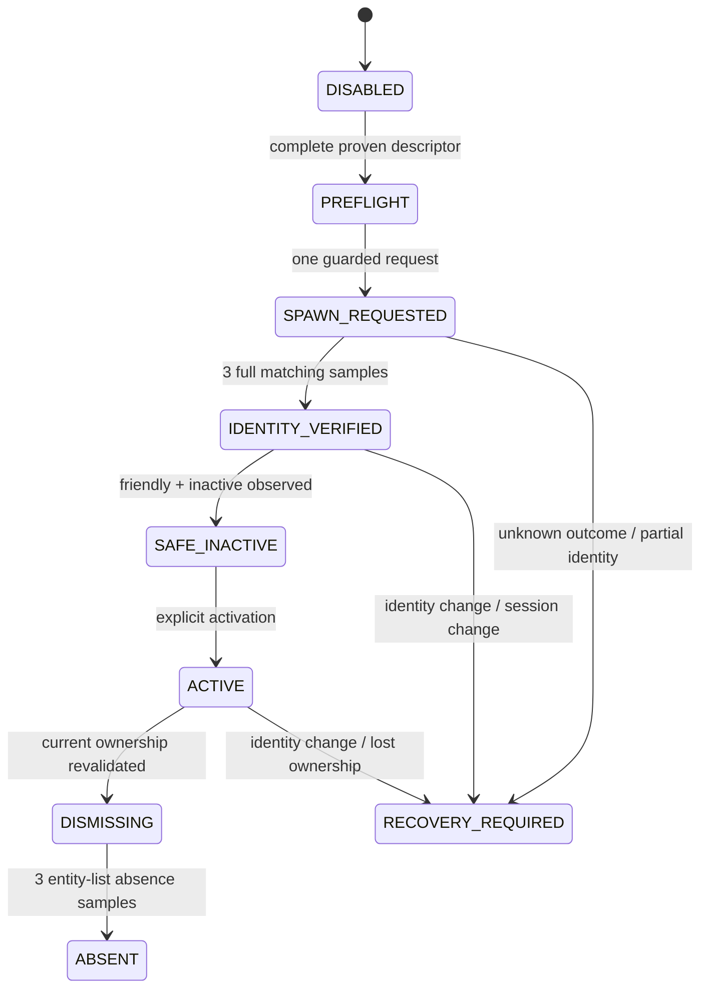

# Архитектура независимого Human NPC Body Adapter

Статус: офлайн-контракт этапа 8; runtime body disabled. Второй игровой клиент и player entity не входят в целевое решение.

```text
AI Brain
   |
Companion Controller (personality UUID, intent, policy)
   |
Human NPC Body Adapter
   +-- Descriptor / Capability Registry
   +-- Identity / Ownership Gate
   +-- Safe Lifecycle / Recovery
   +-- Movement
   +-- Combat
   +-- Interaction
   +-- Inventory / Equipment
   +-- Persistence
   |
EMF -> one local Enshrouded server world
```

Brain хранит личность независимо от entity/session. Body Adapter принимает только ограниченные intent-команды и никогда не выводит неподтверждённый backend в runtime.

## BodyDescriptor и capabilities

`companion.independent_humanoid.HumanBodyDescriptor` фиксирует source, template/npc/model/animation IDs, initial faction, uniqueness, creation marker, ownership proof и safe-dismiss evidence. Отдельный capability registry хранит evidence, scope и `runtime_enabled` для каждой операции.

Все 18 известных survivor descriptors уникальны, имеют неизвестные model/animation/faction и выключены. Неизвестный key не допускает fallback на придуманный GUID. Подтверждение engine-механизма не включает runtime автоматически: например, `GoToPosition` имеет evidence `CONFIRMED` только для existing active survivor, но capability остаётся disabled.

## Identity и ownership

Fingerprint будущего тела:

```text
session
+ EntityId
+ template GUID
+ ModelResource.model
+ AnimationGraphResourceComponent2.animationGraph
+ ActiveNpcState.npcId/kind
+ initial faction
+ creation marker
```

Нужны три последовательных полных одинаковых наблюдения. Reflection error и incomplete fingerprint сбрасывают серию. Любая смена session/entity/template/model/npc/marker переводит gate в `RECOVERY_REQUIRED`. Generation ID в public EMF Lua отсутствует, поэтому creation marker обязателен; без него ownership и право удаления не выдаются.

Типовая идентичность и ownership разделены. Совпадение template/model/npc позволяет распознать вид NPC, но не разрешает mutation или destroy.

## Lifecycle



Текущий каталог не проходит `PREFLIGHT`. Это ожидаемый результат.

Preflight требует одновременно:

- `runtime_enabled=True` после отдельного игрового доказательства;
- `NON_UNIQUE`;
- известные model и animation graph;
- исходную `PlayerAlly` faction 11 до активации;
- creation marker и ownership proof;
- доказанный safe dismiss.

Неизвестный spawn запрещает повтор. После reload с возможной сущностью adapter только диагностирует; он не восстанавливает ownership по одному EntityId и не удаляет совпавшего NPC.

## Интерфейсы

Будущие интерфейсы остаются выключенными до подтверждения backend:

```python
movement.move_to(position)
movement.follow(player_identity)
movement.stay()
movement.look_at(target_identity)
movement.stop()

combat.select_target(target_identity)
combat.attack()
combat.defend(player_identity)
combat.stop()

interaction.use(target_identity)

inventory.list()
inventory.transfer_plain_stack(source, target, item, count)
equipment.equip(slot, pide)
equipment.unequip(slot)
```

Каждая операция требует `ACTIVE`, текущий полный identity sample и включённую capability. Command acceptance, event submission, confirmed state change и long-term behavior — разные результаты. `teleport` не реализует `move_to`; краткая близость не подтверждает follow.

Inventory transfer проектируется как journaled saga: validate both owners -> take exact plain stack -> durable record -> put -> verify. Gear/PIDE запрещён до механизма, сохраняющего level/perks/gem. Equipment требует отдельного подтверждения server state, client visual и animation-set update.

## Recovery и persistence

Внешняя личность хранится по постоянному companion UUID и не зависит от entityId. Runtime binding содержит session/descriptor/creation marker и никогда не переживает session как доверенный handle.

Persistence разделена:

- personality/memory — внешний атомарный файл;
- body descriptor/capability evidence — версия проекта;
- game inventory/body state — только штатное сохранение после доказательства;
- uncertain runtime operation — append-only journal и ручной read-only audit.

`RECOVERY_REQUIRED` разрешает status/survey. Mutating recovery возможен только после повторной полной проверки ownership; текущий API такой проверки не даёт, поэтому операция остаётся заблокированной. Story NPC не используется для cleanup и не удаляется.

## Диагностический мод

`mods/aic_humanoid_survey` выключен в manifest и читает только существующие сущности. `scan` фильтрует nearby `ActiveNpcState`; `inspect` формирует один snapshot. Он показывает отсутствие template GUID в публичном Lua API, а не заполняет поле догадкой.

Мод не входит в пакет `aic_body` и не установлен в игру. Его игровой запуск требует отдельного разрешения и проверенной резервной копии сохранений.

## План первого безопасного испытания

Первое испытание — read-only survey, описанный в [INDEPENDENT_HUMANOID_RESEARCH.md](INDEPENDENT_HUMANOID_RESEARCH.md). Spawn можно обсуждать только после выполнения всех условий:

1. Найден новый non-unique GUID или подтверждён собственный template patch.
2. До появления доказана friendly/inactive конфигурация.
3. Creation marker читается с entity и уникален для запроса.
4. Полный fingerprint стабилен и включает template/model/animation/npc/faction.
5. В пустом тестовом LOCAL-мире доказаны safe dismiss и отсутствие после reload.
6. Ни один story survivor не затрагивается.

Точный следующий шаг к появлению компаньона: сначала разрешённый read-only survey, затем отдельный прототип нового EML template в изолированном исследовательском моде. Прямой spawn workshop survivor не является допустимым коротким путём.
