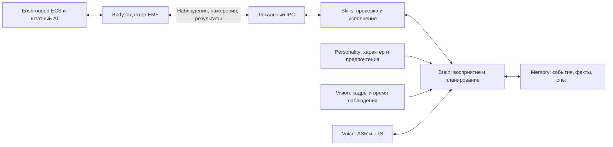

# Исследование enshrouded-ai-companion

Дата: 30 октября 2026 года. Статус: анализ исходников; прототипа нет.

> Это сохранённый отчёт этапа 1. На этапе 2 подготовлен прототип без установки в игру: [контракт реализации](PROTOCOL.md), [инструкция](FIRST_RUN.md), [план проверки](TEST_PLAN.md). Выводы о непроверенной совместимости с игрой пользователя остаются в силе.

## 1. Вывод и границы подтверждения

**Ограниченный компаньон с игровым телом и внешним ИИ технически обоснован исходниками EMF.** Найдены реализация Companion, спавн по GUID шаблона, следование через механизм охраны, удержание позиции через маркер, атака через угрозу, чтение ECS и локальный Python-мост. В upstream также описаны игровые испытания этих механизмов. Это основание предложить проверку минимального варианта, но не подтверждение работоспособности на установленной у пользователя версии игры. [E1][E2][E3][E4][E5]

**Полный автономный напарник пока не подтверждён.** Нет проверенного универсального управления маршрутом боевого тела, произвольного проигрывания анимаций, добычи/строительства/крафта от лица этого тела, камеры из его глаз и синхронизации речи с лицом. Наличие структур движка или возможности записи памяти не считается готовым API действия.

Предварительный выбор: **EMF как адаптер игрового тела + отдельный Python-процесс как Brain**. Причина — существующая реализация Companion и готовый Python-клиент моста. Enshwick остаётся альтернативой: у него есть реальные API спавна, приказов выжившим и угрозы, но в проверенном публичном интерфейсе отправки событий нет события следования EMF. Одновременно устанавливать оба загрузчика не предлагается; их совместимость здесь не проверялась. [E1][E5][E6][W1][W2]

Обозначения доказательств:

- **Код** — объявление и реализация найдены в зафиксированном upstream.
- **Upstream runtime** — авторы upstream описали наблюдение в игре; мы его не воспроизводили.
- **Предложение** — архитектура нашего проекта, ещё не реализована.
- **Не подтверждено** — достаточного публичного API/результата проверки не найдено в исследованной ревизии. Это не утверждение о невозможности реализации.

## 2. Источники и метод

| Источник | Зафиксированная ревизия | Версия и контекст |
|---|---|---|
| [matenm/emf-enshrouded](https://github.com/matenm/emf-enshrouded) | `08d600155fcadc8e45cc9c6f3932a67c717345be` | EMF `0.3.2`, C API `20`; Companion `1.5.0`, manifest требует EMF API `13` [E2][E3][E20] |
| [enshwick/enshwick](https://github.com/enshwick/enshwick) | `135561192969af9ec9ffd0957b97ca6a7aa31820` | workspace ссылается на `enshwick = 1.0.0-alpha.11`; часть API помечена `unstable` [W8][W9] |

Сделаны shallow-копии репозиториев в `.research/emf-enshrouded` и `.research/enshwick`. Прочитаны SDK/API, реализации загрузчиков, Companion, bridge, примеры и исследовательские заметки. Поиск включал `bodyId`, `body_id`, `BodyId`, spawn, NPC commands, guard events, animations, interactions, IPC и voice. Ссылки ниже закреплены за SHA, а не за меняющейся веткой `main`.

Не выполнялись сборка upstream, запуск загруженного кода, подключение к игре, установка/включение модов, включение debug bridge, спавн, изменение конфигурации игры или сохранений. Установленная версия Enshrouded неизвестна. Упоминаемая в заметках EMF сборка `1273043` — контекст испытаний авторов, не сведения о машине пользователя. [E12]

## 3. Где находятся исходники Companion

| Файл EMF | Назначение |
|---|---|
| `mods/companion/companion.cpp` | Интеграция с игрой: summon, фракция, события guard/attack, server tick, колесо приказов, хранение состояния [E1] |
| `mods/companion/mod.json` | Настройки; тело задаёт ключ `guid`, мод по умолчанию выключен [E2] |
| `mods/companion/companion_logic.h` | Жизненный цикл, политика появления, сессии и состояние [E7] |
| `mods/companion/orders.h` | Follow/Stay/Attack, маркер, таймауты и очередь угроз с привязкой к сессии [E8] |
| `mods/companion/gear.h` | Учёт переданных предметов в самом моде и бонус уровня [E9] |
| `tests/test_companion.cpp` | Тесты логики без игры; не доказательство поведения движка [E10] |

Это C++-мод внутри EMF, а не готовый внешний ИИ. При спавне `summon()` получает позицию локального игрока, вызывает `emf::api()->spawn(...)` примерно в двух метрах от него, назначает фракцию и связывает сущность с игроком. `guard_program()` исполняет очереди событий в ECS; регистрация перечисляет `StartGuardingEvent`, `StopGuardingEvent`, `AddThreatTargetEvent`. [E1]

Готового публичного набора команд `companion.follow`, `companion.stay`, `companion.attack` в этом файле **нет**. Найдены консольные `companion.gear` и `companion.aim`; управление приказами идёт через колесо и горячие клавиши. Для структурированных команд внешнего ИИ понадобится собственный адаптер. Наличие bridge само по себе этого адаптера не заменяет. [E1]

## 4. Матрица возможностей

| Возможность | EMF | Enshwick | Оценка для проекта |
|---|---|---|---|
| Спавн игровой сущности | `EmfApi::spawn`, `spawn_ex`; реализованы в core; пример Companion [E1][E3][E11] | `Effects::spawn(template, position, Spawn)`; реализация в loader [W1][W3] | Код есть у обоих. Совместимость конкретного шаблона надо проверять |
| Удаление | `EmfApi::destroy` [E3][E11] | `World::destroy(entity)` [W4] | Код есть; использовать только собственные сущности текущей сессии |
| Идти за игроком | `StartGuardingEvent`, обработка `enemy01`; upstream runtime [E1][E4] | Готовый follow не найден; guard отсутствует в allowlist `emit_raw` [W2] | Для EMF обосновано; перенос на Enshwick не автоматический |
| Остаться на месте | Охрана отдельной статической сущности-маркера [E8][E12] | Аналогичный готовый API не найден | Это охрана области, не точное фиксирование координат |
| Идти в заданную точку | Пример для жителей: `sample::apply_go_to_position`, hook worker, запись состояния [E13] | `Effects::npc_command(npc, NpcCommandType::GoToPosition(...))` для survivor ID [W1] | Не универсальный `moveTo(entityId)` для Vukah |
| Телепортация | `EmfApi::teleport`, API v20, очередь/результат; ограничения по сборке [E14] | `Effects::teleport`, `unstable` [W1][W9] | Есть код, но телепортация не доказывает навигацию |
| Атака цели | `AddThreatTargetEvent`; upstream runtime, ограничения дистанцией охраны [E1][E12] | `Effects::add_threat(attacker, target, threat)` [W1] | Добавление угрозы не гарантирует попадание или достижимость |
| Анимации | Есть отражённые структуры Actor/ActionSequence/AnimationGraph [E15] | В изученном публичном API не найден проигрыватель анимаций | Походка/бой могут следовать штатному AI; произвольные жесты и lip sync не подтверждены |
| Взаимодействия | События, компоненты, API инвентаря; нет общего проверенного `interact` для тела Companion [E3][E15] | `on_interaction` — фильтр действий игрока; `set_toggle` — сигнал игровой логике [W1][W5] | Открыть любой сундук, добывать и крафтить от лица тела не подтверждено |
| Игровые данные | Компоненты, шаблоны, атрибуты, сущности, события; `state` через bridge [E3][E5] | `World`, reflection, game events, inventory [W4][W6][W7][W13] | Наблюдение возможно; полнота зависит от сборки и authority |
| Внешний процесс | Named pipe, JSON, готовый Python-клиент [E5][E6][E16] | Файл команд; `net` относится к клиенту/серверу игры [W10][W11] | EMF имеет более прямую основу для внешнего Brain |
| Зрение | Снимок кадра через bridge и чтение направления камеры игрока [E5][E17][E18] | Аналогичный готовый API получения кадров не найден | Камера тела компаньона не подтверждена |
| Голос | Готовых ASR/TTS/микрофонного интерфейса для Companion не найдено | Не найдено в исследованном публичном API | Внешний ASR/TTS — предложение; внутриигровой пространственный голос не подтверждён |

### 4.1. Потоки и authority

В EMF чтение игровых компонентов и spawn/destroy должны выполняться в разрешённом callback мира. `on_tick` вызывается после шага симуляции; `run_on_world` позволяет поставить работу из другого потока. Указатель на компонент нельзя хранить как устойчивую ссылку между шагами. Для `emit_event` нужен **контекст собственного ECS program**, объявленный `events_out` и совпадающий размер структуры. Отправлять guard-событие непосредственно из Python или произвольного IPC-потока нельзя. [E3]

Предлагаемая цепочка: IPC принимает намерение → очередь с лимитом → server callback проверяет сессию и сущности → ECS program отправляет событие → следующий snapshot подтверждает результат. Ответ «запрос принят» должен отличаться от «цель выполнена».

В Enshwick `Effects` также требует серверный игровой поток; `Scheduler::next_tick` предоставляет очередь задач. События и доступность функций проверяются относительно build table/reflection. `World`, телепортация и ряд других интерфейсов относятся к `unstable`. [W1][W9][W12]

Companion EMF использует `local_player()`. Поэтому первая целевая среда — локально размещённый мир с игроком-хостом. Работа на dedicated server с выбором владельца по account ID потребует адаптации; в bridge на dedicated server локальный игрок отсутствует. Полноценный мультиплеерный сценарий этим исследованием не подтверждён. [E1][E5]

### 4.2. Ограничения следования и перемещения

Guard позволяет штатному AI двигаться к охраняемой сущности. В опытах upstream `FakePlayer_Vukah_Melee` догонял игрока, но в покое мог отходить на несколько метров. Stay реализован созданием бочки-маркера и сменой охраняемой сущности. Это дополнительный объект в мире, который требует очистки при смене приказа/завершении; отсутствие сохранения такого маркера нельзя предполагать без проверки. [E4][E8][E12]

Настройка EMF `follow_distance` меняет **общие данные шаблона** `Enemy01BehaviorState.guardSetup`: изменение влияет и на других существ этого шаблона, включая диких, и на обе копии мира. Для первоначальной проверки оставить значение `0` — использовать штатные дистанции. Это рекомендация конфигурации, сейчас конфигурация не менялась. [E1][E2][E3]

`NpcCommandType::GoToPosition` в Enshwick использует survivor `npcId`, не entity ID боевого компаньона. В EMF пример F7 повторяет обработчик поведения жителей через `NpcWorker` и конкретную структуру worker context. Перенос этого механизма на `enemy01` без дополнительного исследования не обоснован. [W1][E13]

### 4.3. Анимации, взаимодействия и экипировка

EMF генерирует C++-описания `ActionSequence`, `AnimationGraphSlotComponent`, `NpcCommandEvent`, `AcceptOfferedInteractionEvent` и других типов движка. Это описание данных, а не гарантия, что событие можно безопасно инициировать для произвольного тела и получить нужную анимацию. Публичного проверенного `play_animation(entity, clip)` в исследованных интерфейсах не найдено. [E15]

Enshwick `Load::on_interaction` позволяет разрешать/запрещать взаимодействия **игроков**. Наблюдение `AcceptOfferedInteractionEvent` тоже не означает возможность поручить любое такое действие NPC. `Effects::set_toggle` переключает игровой сигнал, но не воспроизводит подход NPC к двери, анимацию и универсальное использование объекта. [W1][W5][W7]

У штатного тела Companion нет Inventory/Equipment по исследованию upstream. `gear.h` хранит экипировку в данных мода; предметы забираются из инвентаря игрока, возвращаются через API, а эффект выражается в бонусе уровня. Это **не подтверждение визуального надевания брони на модель**. В исходнике отдельно отмечена возможность дублирования предмета при определённом сбое возврата. Экипировку исключить из первой проверки тела. [E9][E12]

## 5. Выбор тела и смысл bodyId

Поиск `bodyId`, `body_id`, `BodyId` в обеих скачанных ревизиях не дал совпадений. В исследованных API нет подтверждённого параметра выбора тела с таким именем. EMF Companion использует `guid`, а оба API спавна принимают 16 байт GUID шаблона. [E2][E3][W1]

Нужно разделять четыре значения:

| Значение | Назначение |
|---|---|
| `bodyId` | Если оставить это имя в нашем проекте — только собственный ключ каталога, например `vukah_melee_ally`. Не API игры |
| `templateGuid` | Шаблон создаваемой сущности; он задаёт не только внешний вид, но и компоненты/AI |
| `entityId` | Результат спавна; временный ID экземпляра, недействителен после смерти/выгрузки/смены сессии |
| `npcId` | Идентификатор выжившего в системе NPC; не подмена `entityId` и не номер модели |

Для представления GUID в памяти использовать проверенный парсер фреймворка; строку нельзя без проверки превращать в байты произвольным UUID-кодеком. В Companion для этого используется `emf::parse_guid`. [E1]

### Кандидаты из исходников EMF

| Шаблон и GUID | Свидетельство upstream | Решение |
|---|---|---|
| `Enemy_Vukah_Melee` — `d5d05217-52dc-467a-9192-26b4f661d8d9` | Текущее тело по умолчанию; при смене `Faction` на `11` описаны следование и нормальный урон [E1][E2][E4] | Первый кандидат для согласованной проверки; исходная фракция враждебная, требуется корректная настройка при спавне |
| `FakePlayer_Vukah_Melee` — `9543cfb0-b4d7-408e-905c-ccb79a15136d` | Следует, но при фракции Player удары давали 0 урона [E4] | Демонстрация следования; не готовое боевое тело |
| `Player_Vukah_Melee` — `44604a7b-946b-4727-bb72-8c0eb3c08fa1` | Есть `PlayerInput`; даже после ready-флага в описанном опыте оставался на месте [E4] | Не выбирать на основании имени «Player» |
| `Player_Companion_Skeleton_Melee_GemOfNecromancy` — `10f892be-2374-4d31-ae27-85e0a36f3853` | Следует, но в опыте умер примерно через 55 секунд из-за времени жизни призыва [E4] | Не подходит как долговременное тело без нового исследования |

Проверять каждый кандидат по наличию `CurrentTransform`, `Faction`, `DynamicEnemy01BehaviorState` и `Enemy01BehaviorState`, готовности Actor, времени жизни, исчезновению при удалении от игрока и поведению после загрузки. Наличие `PlayerInput`, Inventory или humanoid-модели само по себе не означает управляемого напарника. Нельзя обещать человеческое тело с произвольной внешностью на основании найденных GUID.

Сохранять постоянную личность компаньона и выбранный template GUID отдельно от runtime `entityId`. EMF имеет `server_session()`; Companion сбрасывает ссылки при смене сессии, поскольку адрес мира и числовые entity ID могут использоваться повторно. Данные штатного Companion лежат в `emf/config/companion/<world slot>.txt`, и мод восстанавливает состояние при загрузке; это не основание писать в существующие сохранения нашего пользователя. [E1][E7]

## 6. Связь с Python / Node.js

### 6.1. Подтверждённый канал EMF

EMF содержит локальный debug bridge:

- Сервер: `src/core/bridge/pipe_server.cpp`, диспетчер и игровые операции — `src/core/bridge/runtime.cpp`. [E16][E17]
- Pipe: `\\.\pipe\emf-bridge-<pid>`; обнаружение через `emf/bridge.txt`. По умолчанию отключён; включение требует `[debug] bridge=1` и перезапуска. **В этом исследовании не включался.** [E5]
- Протокол: UTF-8, один JSON-объект на строку; запрос содержит `id` и `cmd`, ответ возвращает `id`, `ok`, результат/ошибку. Есть unsolicited events; ответы необходимо сопоставлять по ID. Лимиты: 64 KiB запрос, 1 MiB ответ, до 8 клиентов и до 8 ожидающих запросов на клиента. [E5]
- Готовый Python-клиент `tools/bridge/emf_bridge.py`: `Bridge`, `hello()`, `state()`, `console()`, `game_events()`, `screenshot()`. Использует стандартную библиотеку и Win32 через ctypes; проверяет процесс сервера pipe. [E6]
- MCP-обёртка `tools/mcp/emf_mcp.py` существует для инструментов разработки. Она не является автономным Brain; у неё отдельные ограничения игровых сессий. [E19]

`state` возвращает состояние мира, локального игрока, модов и диагностики. **Это не готовое полное состояние Companion**: его здоровье, текущий guard target, session и результат последнего приказа нужно экспортировать своим адаптером. Консоль может читать компоненты и выполнять зарегистрированные команды, но произвольную строку от модели нельзя принимать за проверенный навык. [E5][E1]

Bridge предназначен для отладки, имеет широкие полномочия консоли и локальные ограничения доступа. Для ранней проверки он подходит как существующий транспорт. Для автономного режима предлагается ограниченный командный интерфейс адаптера: только проверенные намерения и наблюдения, без произвольного eval, memory write, установки модов или управления сохранениями.

### 6.2. Python и Node.js: что уже есть, что предстоит написать

**Python — предпочтительный первый вариант:** готовый клиент уже реализует framing, обнаружение pipe, проверку процесса, ожидания и ошибки. Внешний Brain может использовать этот клиент после согласованного включения моста. Lua внутри EMF не следует считать способом запуска Brain: в документации Lua запрещены `os.execute`, `io.popen`, `package.loadlib`; процесс предлагается запускать отдельно. [E6][E21]

**Node.js — возможная архитектурная альтернатива, не готовая интеграция из upstream.** Потребуется собственный клиент Windows pipe с тем же протоколом либо небольшой Python-посредник. Портировать нужно не только JSON Lines, но и ограничения размеров, таймауты, разделение ответов/событий, проверку принадлежности pipe процессу игры и корректное переподключение. Node-клиент в рамках исследования не написан и не проверен.

Для Enshwick подтверждён файл `mod-data/enshwick/commands.txt`: завершённые строки исполняются на консоли; polling около секунды; существующие на старте строки пропускаются. Это канал управления с ограниченной пригодностью для частых наблюдений, не готовый двунаправленный Brain API. `enshwick::net` передаёт сообщения между частями мода на игровом сервере и клиенте; это **не внешний TCP/WebSocket-сервис для Python**. Эквивалента EMF bridge в исследованных исходниках не найдено. Собственный IPC в Rust — отдельная будущая разработка. [W10][W11]

### 6.3. Зрение и голос

Подтверждённый путь к изображению — screenshot следующего отображаемого кадра через EMF bridge. Runtime вызывает механизм capture и пишет PNG в `emf/screens`. Это запись изображения на диск, хотя игровое состояние не меняет. Dedicated server не имеет этого источника изображения. `emf::aim::camera_ray()` читает камеру **игрока**, а `pick()` выбирает точки относительно луча; это не физический raycast препятствий и не доказательство видимости цели. [E5][E17][E18]

Предложение: vision-модуль внешнего процесса анализирует редкие кадры вместе со snapshot и отметкой времени. Различать «видно на экране игрока» и «известно из ECS». Зрение из глаз компаньона, отдельный render target, проверка line of sight от его головы и управление камерой требуют отдельного подтверждения.

Голос предлагается реализовать снаружи: микрофон → ASR → Brain; текст ответа → TTS → аудиовыход компьютера. Это пока проектный канал речи. Привязка звука к позиции тела, воспроизведение через аудиодвижок Enshrouded и lip sync в изученных API не подтверждены. Выбор провайдера модели/ASR/TTS, отправка кадров и аудио во внешние сервисы в этот этап не входят.

## 7. Предлагаемая архитектура

Все названия компонентов и контрактов в этом разделе — **проектное предложение**, а не существующие API EMF/Enshwick.

| Слой | Ответственность | Граница |
|---|---|---|
| **Body** | Единственный владелец игровой сущности; lifecycle, template GUID, session, snapshot, исполнение событий через правильные callbacks | Никаких сетевых ожиданий модели на игровом потоке; работает только с проверенными возможностями |
| **Brain** | Объединяет речь, изображение и игровые данные, выбирает цель, предлагает последовательность навыков, оценивает результат | Не пишет память игры, не создаёт консольные строки произвольного вида |
| **Personality** | Имя, манера речи, ценности, предпочтения помощи/боя и отношения | Характер влияет на выбор разрешённых действий, но не создаёт отсутствующие способности |
| **Skills** | Детерминированные условия запуска, выполнение, таймауты, отмена и проверка результата | Skill доступен только при подтверждённой capability нужного тела/сборки |
| **Memory** | Личность, факты, история диалогов и навыков; отдельно краткосрочное состояние мира | Внешнее хранилище проекта; runtime IDs не превращаются в постоянную идентичность |

Первым кандидатом хранилища Memory предлагается SQLite вне папки игры: события с временем, источником и уверенностью; профиль персонажа; эпизоды; итоги действий. Факты ECS, слова пользователя и выводы vision/LLM хранить с разным происхождением. Краткосрочные ссылки на сущности ограничивать конкретной сессией. Векторный поиск добавлять только если простого поиска по фактам и эпизодам окажется недостаточно.

### Контракт Body ↔ Brain

Предлагаемые данные:

- Наблюдение: версия протокола, build игры, версия адаптера, world key, session, собственный companion key, entity ID, template GUID, timestamp/tick, доступные capabilities, положение/здоровье/guard target, ближайшие сущности.
- Намерение: уникальный request ID, ожидаемая session, навык, цель и параметры, срок актуальности. Повторный запрос не должен повторно создавать тело или маркер.
- Результат: `accepted`, затем `succeeded`, `failed`, `cancelled` или `unsupported`, с наблюдаемой причиной. Подтверждение IPC не равно успеху игрового действия.

При переподключении читать новый snapshot, сбрасывать устаревшие цели и не восстанавливать старые entity ID. При потере Brain прекращать новые автономные команды; отдельно учитывать, что штатный guard/бой может продолжаться — остановка IPC не гарантирует физической остановки NPC. Политику безопасного выхода из приказа нужно подтвердить испытанием.

### Начальный каталог навыков

| Навык проекта | Реальный механизм | Статус |
|---|---|---|
| Observe | Snapshot + компоненты + события | Код механизмов есть; экспорт состояния собственного тела надо написать |
| Speak | Внешний TTS | Предложение; в игре не реализовано |
| FollowOwner | EMF `StartGuardingEvent` | Подтверждено upstream; локальная проверка ещё нужна |
| StayNearMarker | Создать маркер и сменить guard target | Подтверждено upstream; требует разрешения на дополнительную сущность |
| AttackTarget | `AddThreatTargetEvent`, контроль дистанции/смерти/таймаута | Подтверждено upstream; не гарантирует достижение цели |
| Dismiss | Очередь остановки охраны и destroy собственного тела | Реализовано в Companion; локально не проверено |
| MoveTo / Gather / Craft / Build / PlayGesture | Для выбранного Vukah нет достаточного проверенного интерфейса | Недоступны до дальнейшего исследования |

Планирование Brain работает по событиям и ограниченной частоте, а движение и бой оставляет штатному игровому AI. Начальные частоты снимков/телеметрии выбрать измерением нагрузки; никаких обещаний real-time зрения по debug bridge здесь нет.

## 8. Условия перехода к прототипу

На этом этапе выполнено **подтверждение по исходникам** для спавна, guard-follow и внешнего Python-транспорта. **Проверка в среде пользователя не выполнена.** Прототип на этапе исследования не создаётся.

Следующий этап после согласования:

1. Уточнить установленную сборку игры, локальный/host/dedicated сценарий и уже установленные моды. Сопоставить сборку с поддержкой конкретной ревизии EMF.
2. Отдельно согласовать установку EMF и включение debug bridge, если их ещё нет. Проверки проводить на выделенном локальном тестовом персонаже и мире; не открывать основной мир ради эксперимента. Резервирование и запуск тоже выполняются только в согласованном объёме.
3. Сначала проверить `hello`/`state`, совпадение версии и возможность чтения. Наличие кода и успешная компиляция не заменяют этой проверки.
4. После разрешения на изменение тестового мира проверить один экземпляр `Enemy_Vukah_Melee`, смену фракции, готовность, guard-follow и удаление. Критерий — устойчивое следование за несколькими перемещениями игрока, отсутствие атаки владельца и корректная очистка.
5. Проверить смерть, исчезновение тела, смену сессии, перезапуск внешнего процесса и недействительные entity ID. Отдельно — маркер Stay, поведение после загрузки и очистку. Бой проверять только после согласования этого сценария.
6. Зафиксировать результаты как `подтверждено на build X / не работает / не проверялось`. Лишь затем реализовать минимальный Body-adapter и внешний Brain для подтверждённого набора навыков. Голос и анализ кадров подключать отдельно после согласования источников и провайдеров.

Неподтверждённые возможности не должны появляться в контракте как работающие. При несовпадении сборки, размеров компонентов или отсутствующих signatures адаптер должен сообщать `unsupported` и не пытаться обходить проверку записью по найденным в старых заметках адресам.

## 9. Индекс доказательств

Ссылки ведут на точные версии файлов; фрагменты с номерами строк позволяют проверить утверждения. Основные функции и ограничения описаны выше своими словами.

### EMF

- [E1 — Companion: события, summon, lifecycle, команды](https://github.com/matenm/emf-enshrouded/blob/08d600155fcadc8e45cc9c6f3932a67c717345be/mods/companion/companion.cpp#L147-L213). Дополнительно в том же файле: `apply_follow` L109–131; persistence L282–339; приказы L359 и далее; tick L653–711; регистрация L768–795.
- [E2 — manifest Companion и GUID тела](https://github.com/matenm/emf-enshrouded/blob/08d600155fcadc8e45cc9c6f3932a67c717345be/mods/companion/mod.json#L1-L28).
- [E3 — C API: миры, компоненты, callbacks, spawn и события](https://github.com/matenm/emf-enshrouded/blob/08d600155fcadc8e45cc9c6f3932a67c717345be/sdk/include/emf/emf_api.h#L300-L427). Правила потоков также L1–16, API_VERSION L29, `server_session` L477, `attribute_get` L578.
- [E4 — исследование guard, кандидаты тела и runtime-наблюдения](https://github.com/matenm/emf-enshrouded/blob/08d600155fcadc8e45cc9c6f3932a67c717345be/docs/engine_parts/re_companions.md#L1-L46).
- [E5 — документация debug bridge и JSON-протокола](https://github.com/matenm/emf-enshrouded/blob/08d600155fcadc8e45cc9c6f3932a67c717345be/docs/modding/debug_bridge.md#L1-L137). `state` — L170 и далее, screenshot описан в этом же документе.
- [E6 — Python Bridge: открытие pipe, проверка процесса, request/response](https://github.com/matenm/emf-enshrouded/blob/08d600155fcadc8e45cc9c6f3932a67c717345be/tools/bridge/emf_bridge.py#L328-L525).
- [E7 — Companion lifecycle](https://github.com/matenm/emf-enshrouded/blob/08d600155fcadc8e45cc9c6f3932a67c717345be/mods/companion/companion_logic.h).
- [E8 — логика приказов, маркера и сессий](https://github.com/matenm/emf-enshrouded/blob/08d600155fcadc8e45cc9c6f3932a67c717345be/mods/companion/orders.h).
- [E9 — экипировка в данных мода и ограничения](https://github.com/matenm/emf-enshrouded/blob/08d600155fcadc8e45cc9c6f3932a67c717345be/mods/companion/gear.h#L1-L25).
- [E10 — тесты Companion](https://github.com/matenm/emf-enshrouded/blob/08d600155fcadc8e45cc9c6f3932a67c717345be/tests/test_companion.cpp).
- [E11 — реализация spawn/destroy](https://github.com/matenm/emf-enshrouded/blob/08d600155fcadc8e45cc9c6f3932a67c717345be/src/core/api.cpp#L688-L780).
- [E12 — upstream-проверки приказов и боевых параметров на build 1273043](https://github.com/matenm/emf-enshrouded/blob/08d600155fcadc8e45cc9c6f3932a67c717345be/docs/engine_parts/re_companion_orders.md#L1-L39).
- [E13 — перемещение жителя через worker context](https://github.com/matenm/emf-enshrouded/blob/08d600155fcadc8e45cc9c6f3932a67c717345be/mods/sample_mod/npc_command.h#L1-L59); [подключение hook в sample_mod](https://github.com/matenm/emf-enshrouded/blob/08d600155fcadc8e45cc9c6f3932a67c717345be/mods/sample_mod/sample_mod.cpp#L198-L282).
- [E14 — контракт телепортации EMF](https://github.com/matenm/emf-enshrouded/blob/08d600155fcadc8e45cc9c6f3932a67c717345be/sdk/include/emf/emf_api.h#L632-L652); [реализация api_teleport](https://github.com/matenm/emf-enshrouded/blob/08d600155fcadc8e45cc9c6f3932a67c717345be/src/core/api.cpp#L1382).
- [E15 — сгенерированные структуры анимаций](https://github.com/matenm/emf-enshrouded/blob/08d600155fcadc8e45cc9c6f3932a67c717345be/sdk/include/emf/generated/components.hpp#L426-L603). События в том же файле: `AcceptOfferedInteractionEvent` L24780; `AddThreatTargetEvent` L24897; `NpcCommandEvent` L26300; `StartGuardingEvent` L26859; `StopGuardingEvent` L26909.
- [E16 — реализация named pipe](https://github.com/matenm/emf-enshrouded/blob/08d600155fcadc8e45cc9c6f3932a67c717345be/src/core/bridge/pipe_server.cpp#L130-L190).
- [E17 — bridge runtime: сбор state и захват кадра](https://github.com/matenm/emf-enshrouded/blob/08d600155fcadc8e45cc9c6f3932a67c717345be/src/core/bridge/runtime.cpp#L179-L290); [запись screenshot](https://github.com/matenm/emf-enshrouded/blob/08d600155fcadc8e45cc9c6f3932a67c717345be/src/core/bridge/screens.cpp#L167).
- [E18 — camera_ray и геометрический выбор точки](https://github.com/matenm/emf-enshrouded/blob/08d600155fcadc8e45cc9c6f3932a67c717345be/sdk/include/emf/aim.hpp#L1-L100).
- [E19 — Python MCP-обёртка и ограничения её назначения](https://github.com/matenm/emf-enshrouded/blob/08d600155fcadc8e45cc9c6f3932a67c717345be/tools/mcp/emf_mcp.py#L1-L24).
- [E20 — версия EMF](https://github.com/matenm/emf-enshrouded/blob/08d600155fcadc8e45cc9c6f3932a67c717345be/VERSION).
- [E21 — ограничения Lua host](https://github.com/matenm/emf-enshrouded/blob/08d600155fcadc8e45cc9c6f3932a67c717345be/docs/modding/lua.md#L72-L81).

### Enshwick

- [W1 — Effects: NPC orders, toggle, threat, teleport, spawn](https://github.com/enshwick/enshwick/blob/135561192969af9ec9ffd0957b97ca6a7aa31820/crates/enshwick/src/effects.rs#L235-L569). Контракты потока — L1–20; `npc_command` L325–360, `add_threat` L386–413, `emit_raw` L441–468, spawn L522–569.
- [W2 — allowlist отправляемых событий](https://github.com/enshwick/enshwick/blob/135561192969af9ec9ffd0957b97ca6a7aa31820/crates/internal/loader/src/emits.rs#L43-L50). Проверка события — функция `emit` в том же файле; произвольный тип через `emit_raw` не разрешён.
- [W3 — реализация спавна в loader](https://github.com/enshwick/enshwick/blob/135561192969af9ec9ffd0957b97ca6a7aa31820/crates/internal/loader/src/spawns.rs#L157-L218); [маршрутизация ABI в spawn](https://github.com/enshwick/enshwick/blob/135561192969af9ec9ffd0957b97ca6a7aa31820/crates/internal/loader/src/host/entries/world.rs#L425).
- [W4 — поиск сущностей, near и destroy](https://github.com/enshwick/enshwick/blob/135561192969af9ec9ffd0957b97ca6a7aa31820/crates/enshwick/src/world/entities.rs#L1-L118).
- [W5 — фильтры взаимодействий игроков](https://github.com/enshwick/enshwick/blob/135561192969af9ec9ffd0957b97ca6a7aa31820/crates/enshwick/src/interactions.rs#L1-L142).
- [W6 — компоненты, position и template](https://github.com/enshwick/enshwick/blob/135561192969af9ec9ffd0957b97ca6a7aa31820/crates/enshwick/src/world.rs#L397-L640).
- [W7 — чтение событий игры](https://github.com/enshwick/enshwick/blob/135561192969af9ec9ffd0957b97ca6a7aa31820/crates/enshwick/src/game_events.rs#L1-L71).
- [W8 — версии workspace](https://github.com/enshwick/enshwick/blob/135561192969af9ec9ffd0957b97ca6a7aa31820/Cargo.toml#L20-L43).
- [W9 — границы stable/unstable и ABI до 1.0](https://github.com/enshwick/enshwick/blob/135561192969af9ec9ffd0957b97ca6a7aa31820/book/src/stability.md).
- [W10 — файловый канал команд](https://github.com/enshwick/enshwick/blob/135561192969af9ec9ffd0957b97ca6a7aa31820/crates/internal/loader/src/console/file.rs#L1-L24).
- [W11 — net: сообщения между игровыми клиентом и сервером](https://github.com/enshwick/enshwick/blob/135561192969af9ec9ffd0957b97ca6a7aa31820/crates/enshwick/src/net.rs#L1-L55).
- [W12 — Scheduler и работа на игровом потоке](https://github.com/enshwick/enshwick/blob/135561192969af9ec9ffd0957b97ca6a7aa31820/crates/enshwick/src/schedule.rs#L1-L18); [next_tick](https://github.com/enshwick/enshwick/blob/135561192969af9ec9ffd0957b97ca6a7aa31820/crates/enshwick/src/schedule.rs#L160-L173).
- [W13 — чтение инвентарей и транзакции](https://github.com/enshwick/enshwick/blob/135561192969af9ec9ffd0957b97ca6a7aa31820/crates/enshwick/src/inventory.rs#L1-L17).

<!-- Ссылки на доказательства для обозначений в тексте. -->
[E1]: https://github.com/matenm/emf-enshrouded/blob/08d600155fcadc8e45cc9c6f3932a67c717345be/mods/companion/companion.cpp#L147-L213
[E2]: https://github.com/matenm/emf-enshrouded/blob/08d600155fcadc8e45cc9c6f3932a67c717345be/mods/companion/mod.json#L1-L28
[E3]: https://github.com/matenm/emf-enshrouded/blob/08d600155fcadc8e45cc9c6f3932a67c717345be/sdk/include/emf/emf_api.h#L300-L427
[E4]: https://github.com/matenm/emf-enshrouded/blob/08d600155fcadc8e45cc9c6f3932a67c717345be/docs/engine_parts/re_companions.md#L1-L46
[E5]: https://github.com/matenm/emf-enshrouded/blob/08d600155fcadc8e45cc9c6f3932a67c717345be/docs/modding/debug_bridge.md#L1-L137
[E6]: https://github.com/matenm/emf-enshrouded/blob/08d600155fcadc8e45cc9c6f3932a67c717345be/tools/bridge/emf_bridge.py#L328-L525
[E7]: https://github.com/matenm/emf-enshrouded/blob/08d600155fcadc8e45cc9c6f3932a67c717345be/mods/companion/companion_logic.h
[E8]: https://github.com/matenm/emf-enshrouded/blob/08d600155fcadc8e45cc9c6f3932a67c717345be/mods/companion/orders.h
[E9]: https://github.com/matenm/emf-enshrouded/blob/08d600155fcadc8e45cc9c6f3932a67c717345be/mods/companion/gear.h#L1-L25
[E10]: https://github.com/matenm/emf-enshrouded/blob/08d600155fcadc8e45cc9c6f3932a67c717345be/tests/test_companion.cpp
[E11]: https://github.com/matenm/emf-enshrouded/blob/08d600155fcadc8e45cc9c6f3932a67c717345be/src/core/api.cpp#L688-L780
[E12]: https://github.com/matenm/emf-enshrouded/blob/08d600155fcadc8e45cc9c6f3932a67c717345be/docs/engine_parts/re_companion_orders.md#L1-L39
[E13]: https://github.com/matenm/emf-enshrouded/blob/08d600155fcadc8e45cc9c6f3932a67c717345be/mods/sample_mod/npc_command.h#L1-L59
[E14]: https://github.com/matenm/emf-enshrouded/blob/08d600155fcadc8e45cc9c6f3932a67c717345be/sdk/include/emf/emf_api.h#L632-L652
[E15]: https://github.com/matenm/emf-enshrouded/blob/08d600155fcadc8e45cc9c6f3932a67c717345be/sdk/include/emf/generated/components.hpp#L426-L603
[E16]: https://github.com/matenm/emf-enshrouded/blob/08d600155fcadc8e45cc9c6f3932a67c717345be/src/core/bridge/pipe_server.cpp#L130-L190
[E17]: https://github.com/matenm/emf-enshrouded/blob/08d600155fcadc8e45cc9c6f3932a67c717345be/src/core/bridge/runtime.cpp#L179-L290
[E18]: https://github.com/matenm/emf-enshrouded/blob/08d600155fcadc8e45cc9c6f3932a67c717345be/sdk/include/emf/aim.hpp#L1-L100
[E19]: https://github.com/matenm/emf-enshrouded/blob/08d600155fcadc8e45cc9c6f3932a67c717345be/tools/mcp/emf_mcp.py#L1-L24
[E20]: https://github.com/matenm/emf-enshrouded/blob/08d600155fcadc8e45cc9c6f3932a67c717345be/VERSION
[E21]: https://github.com/matenm/emf-enshrouded/blob/08d600155fcadc8e45cc9c6f3932a67c717345be/docs/modding/lua.md#L72-L81
[W1]: https://github.com/enshwick/enshwick/blob/135561192969af9ec9ffd0957b97ca6a7aa31820/crates/enshwick/src/effects.rs#L235-L569
[W2]: https://github.com/enshwick/enshwick/blob/135561192969af9ec9ffd0957b97ca6a7aa31820/crates/internal/loader/src/emits.rs#L43-L50
[W3]: https://github.com/enshwick/enshwick/blob/135561192969af9ec9ffd0957b97ca6a7aa31820/crates/internal/loader/src/spawns.rs#L157-L218
[W4]: https://github.com/enshwick/enshwick/blob/135561192969af9ec9ffd0957b97ca6a7aa31820/crates/enshwick/src/world/entities.rs#L1-L118
[W5]: https://github.com/enshwick/enshwick/blob/135561192969af9ec9ffd0957b97ca6a7aa31820/crates/enshwick/src/interactions.rs#L1-L142
[W6]: https://github.com/enshwick/enshwick/blob/135561192969af9ec9ffd0957b97ca6a7aa31820/crates/enshwick/src/world.rs#L397-L640
[W7]: https://github.com/enshwick/enshwick/blob/135561192969af9ec9ffd0957b97ca6a7aa31820/crates/enshwick/src/game_events.rs#L1-L71
[W8]: https://github.com/enshwick/enshwick/blob/135561192969af9ec9ffd0957b97ca6a7aa31820/Cargo.toml#L20-L43
[W9]: https://github.com/enshwick/enshwick/blob/135561192969af9ec9ffd0957b97ca6a7aa31820/book/src/stability.md
[W10]: https://github.com/enshwick/enshwick/blob/135561192969af9ec9ffd0957b97ca6a7aa31820/crates/internal/loader/src/console/file.rs#L1-L24
[W11]: https://github.com/enshwick/enshwick/blob/135561192969af9ec9ffd0957b97ca6a7aa31820/crates/enshwick/src/net.rs#L1-L55
[W12]: https://github.com/enshwick/enshwick/blob/135561192969af9ec9ffd0957b97ca6a7aa31820/crates/enshwick/src/schedule.rs#L1-L18
[W13]: https://github.com/enshwick/enshwick/blob/135561192969af9ec9ffd0957b97ca6a7aa31820/crates/enshwick/src/inventory.rs#L1-L17
